# Achintya Matrimony CRM — End-to-End System & Workflow Documentation

---

## 📌 Executive Summary

**Achintya Matrimony** is a specialized, private matrimony management platform and counselor-moderated CRM built for discreet, family-oriented matrimonial matchmaking. Unlike mass-market public dating or matrimonial sites where profiles are openly crawled and indexed by search engines, Achintya operates on an **exclusive, counselor-moderated confidentiality model**:
- **Public Domain:** Candidates and families register their profiles securely without fear of exposure.
- **Counselor Moderation:** Experienced matrimonial counselors verify candidate identities, educational degrees, family background, and astrological data.
- **Administrative CRM:** Matrimonial matchmaking, personalized introductions, follow-up scheduling, and confidential profile sharing are orchestrated through an enterprise admin portal.

---

## 🏗️ Technology Architecture & Core Stack

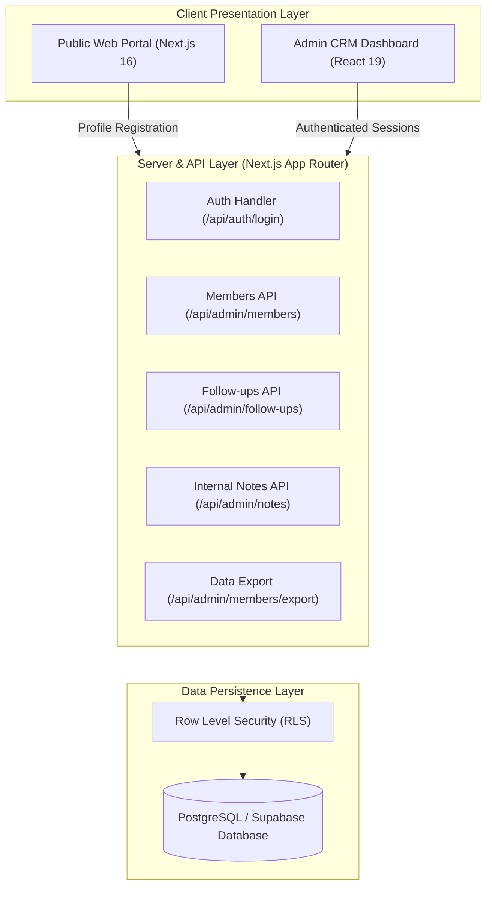

- **Frontend & Framework:** Next.js 16.4.0 (Turbopack) with React 19.
- **Database & Storage:** PostgreSQL with Supabase SSR integration (`@supabase/ssr`, `@supabase/supabase-js`, `pg`).
- **Styling Architecture:** Custom CSS variable token design system with Indian heritage aesthetic (Crimson `#941B2B`, Warm Amber/Gold `#D4AF37`, Cream Pearl background).
- **Export Engine:** Native Excel (`.xlsx`) via SheetJS and Universal CSV export.
- **Security:** Strict Server-side session verification, RLS policies, and sanitized inputs.

---

## 🔄 End-to-End Operational Lifecycle

The system operates across two core user roles: **Candidates / Families (Public)** and **Matchmaking Administrators / Counselors (Admin CRM)**.

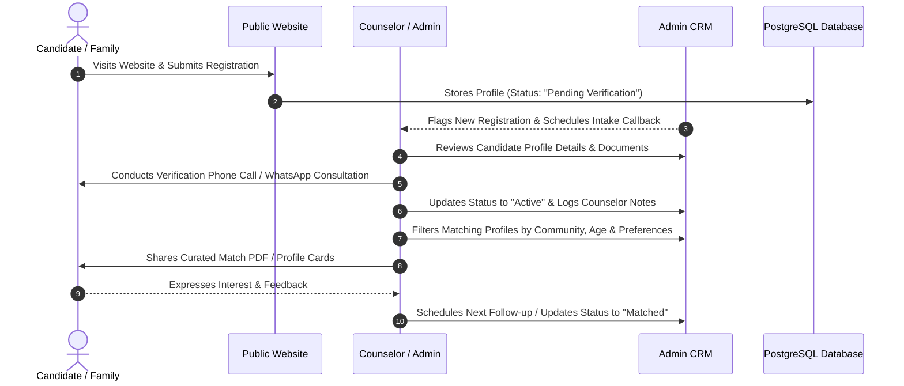

---

## 🌐 Public Web Portal Tour

### 1. Public Landing Page (`/`)

The landing page establishes credibility, reassurance, and clear value propositions for prospective brides, grooms, and their parents.

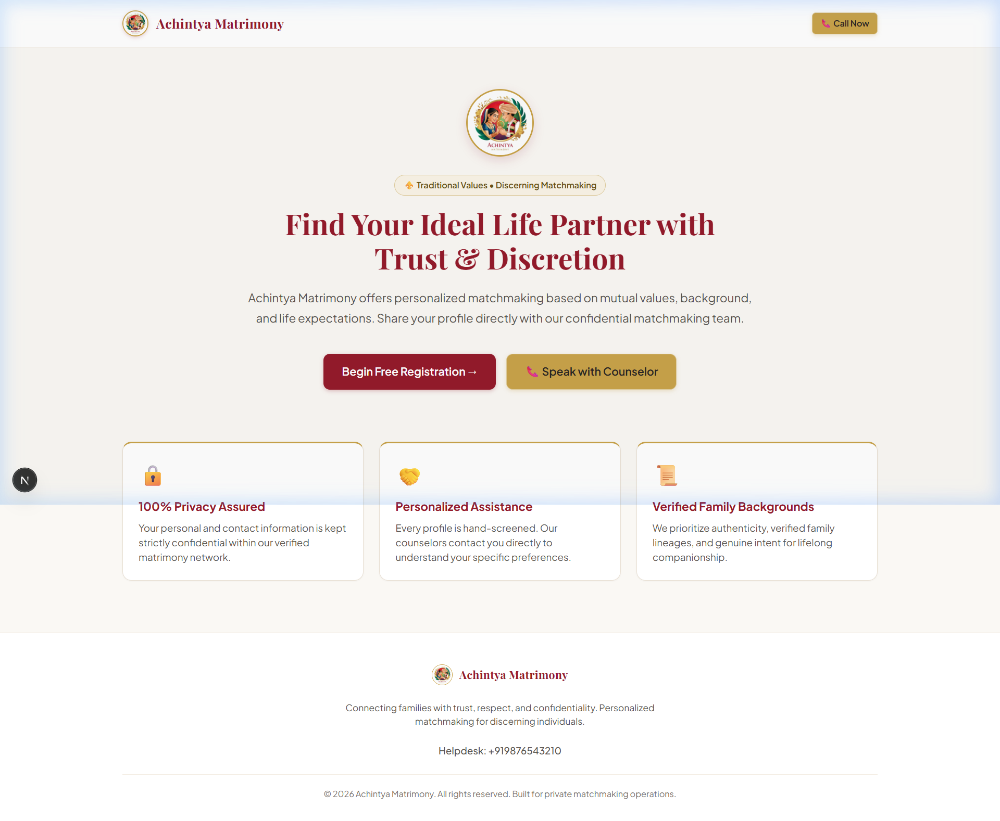

#### Key Sections:
- **Header & Navigation:** Brand insignia, quick helpline phone trigger (`+91 98765 43210`), and prominent call-to-action button *"Register Profile"*.
- **Hero Banner:** Tagline: *"Connecting Families with Trust, Respect, and Confidentiality"*.
- **The Counselor Advantage:** Clear messaging explaining why counselor-moderated matching is safer than self-service dating apps.
- **4-Step Matching Methodology:**
  1. *Register Profile:* Submit comprehensive family and personal credentials.
  2. *Counselor Verification:* In-depth background consultation by phone or video.
  3. *Curated Introductions:* Hand-selected matches tailored to cultural and lifestyle expectations.
  4. *Family Meeting:* Coordinated discussions in a dignified, confidential setting.

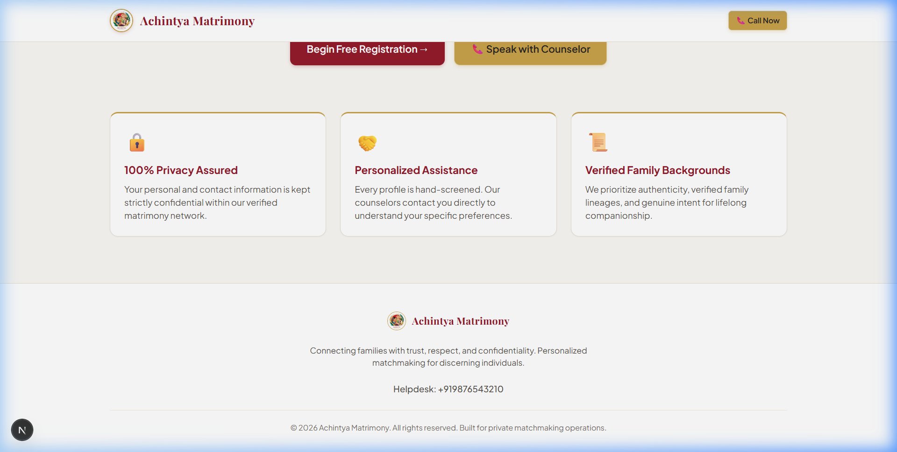

---

### 2. Candidate Registration Portal (`/register`)

The registration form is designed as a structured intake questionnaire categorized into four distinct sections to prevent cognitive overload.

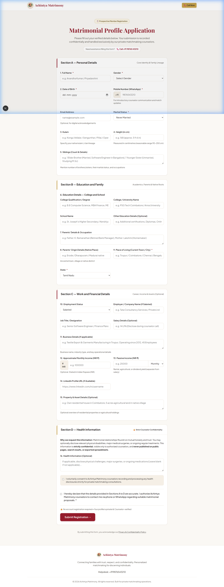

#### Detailed Field Architecture:

| Section | Form Fields | Validation Rules |
| :--- | :--- | :--- |
| **A. Personal Details** | Full Name, Gender (Male / Female), Date of Birth, WhatsApp Mobile Number, Email Address, Marital Status (Never Married, Divorced, Widowed), Kulam / Community, Height (cm / ft), Siblings Count & Status | Required Name, Valid 10-digit WhatsApp phone, DOB age >= 18 |
| **B. Education & Family** | Highest Degree & College/University, Schooling Name, Father's Name & Profession, Mother's Name & Profession, Native Place / Ancestral Town, Current Residential Town & State | Degree & Native place required |
| **C. Profession & Finances** | Employment Type (Salaried, Self-Employed, Business Owner, Government), Company / Firm Name, Designation, Annual CTC / Salary Range, Monthly Income, Passive Income, LinkedIn Profile URL, Property & Asset Details | Confidential financial disclosure |
| **D. Health & Consent** | Confidential Health Disclosures, Verification Call Consent Checkbox, WhatsApp Communication Consent | Mandatory agreement to counselor contact |

---

### 3. Support & Privacy Governance (`/contact` & `/privacy`)

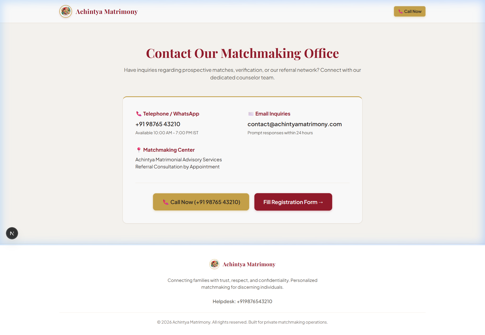

- **Helpline Assistance:** Direct counselor telephone dispatch, support email (`contact@achintyamatrimony.com`), and physical consultation hours.
- **Zero Public Search Indexing Guarantee:** Strict privacy policy preventing search bots from indexing candidate bios, pictures, or phone numbers.

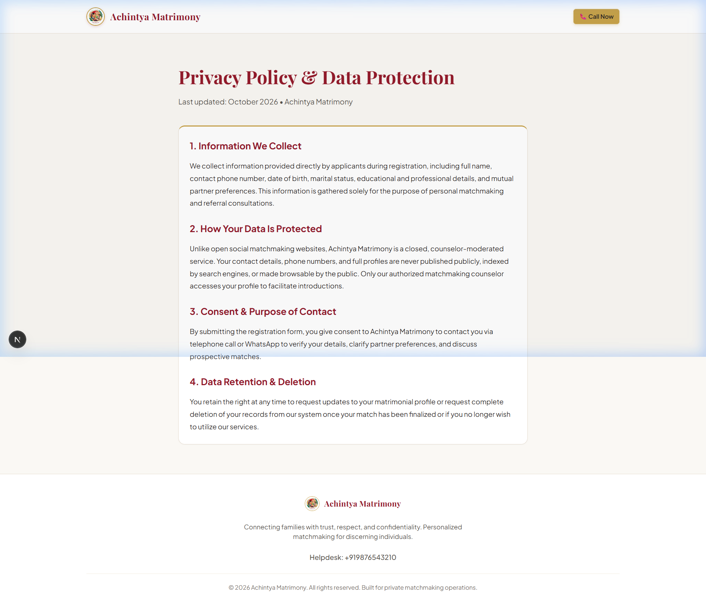

---

## 🔐 Admin Authentication Portal (`/login`)

The Administrative Portal is protected against unauthorized access with dual-mode authentication:
1. **Supabase Auth Service:** Production enterprise session tokens stored in secure `httpOnly` cookies.
2. **Local Development Fallback:** Automated administrative bypass using configured environment credentials (`admin@achintyamatrimony.com` / `Achintya@Admin2026`).

---

## 📊 Admin CRM System Workflows

### 1. Executive Operations Dashboard (`/admin`)

The command center gives counselors an immediate operational snapshot of active inventory and urgent tasks.

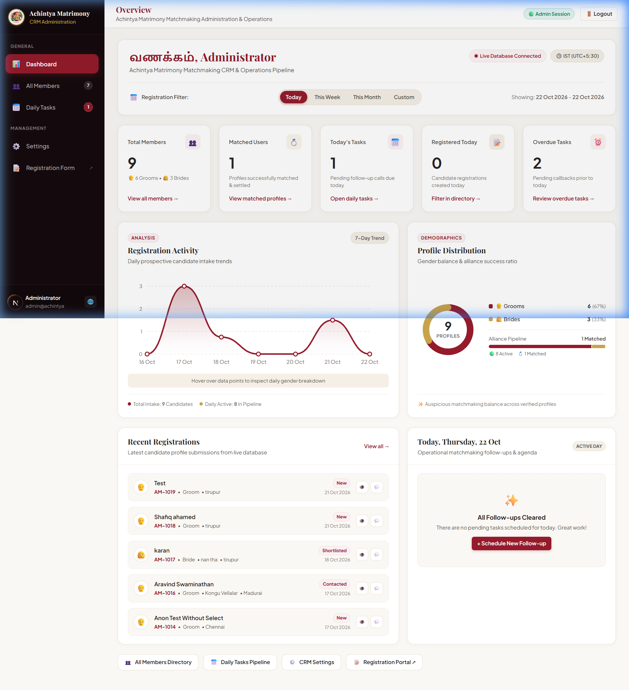

#### Dashboard Modules:
- **KPI Metrics Cards:**
  - *Total Members:* Live aggregate count with groom/bride breakdown (e.g., 9 Total: 6 Grooms, 3 Brides).
  - *Matched Users:* Successfully engaged or married profiles.
  - *Today's Tasks:* Scheduled counselor callbacks requiring immediate execution.
  - *Registered Today:* New inbound leads awaiting first-touch verification.
  - *Overdue Tasks:* Escalated follow-ups that missed their scheduled SLA.
- **7-Day Intake Trend Chart:** Visual bar analytics showing daily inbound registration volume.
- **Community & Gender Breakdown:** Visual demographic distribution (67% Grooms vs 33% Brides).
- **Recent Registrations Queue:** Direct action triggers to launch WhatsApp conversations or telephone calls.

---

### 2. Members Management Directory (`/admin/members`)

The core repository allowing counselors to filter, inspect, and export candidates.

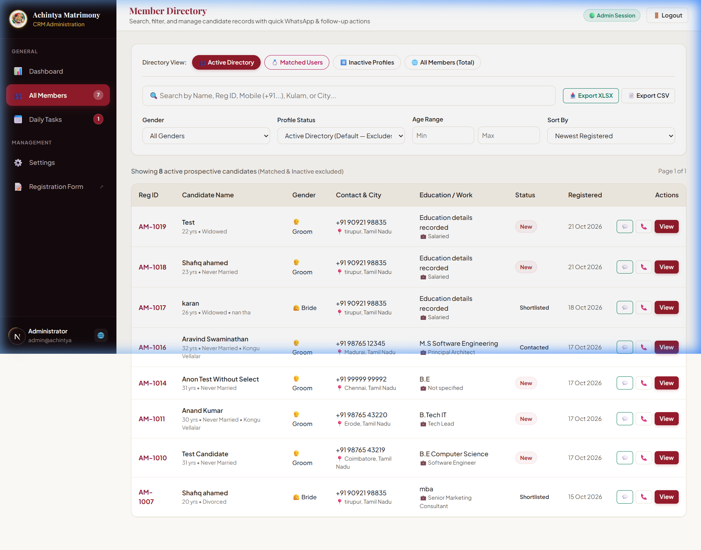

#### Search, Filter & Export Capabilities:
- **Quick Status Tabs:** `Active Directory`, `Matched Users`, `Inactive Profiles`, and `All Members (Total)`.
- **Omni-Search Bar:** Instant filtering across Candidate Name, Unique Registration ID (`AM-1019`), Contact Number, Kulam/Gotra, or Hometown.
- **Multi-Attribute Filters:**
  - Gender (`Male` / `Female`)
  - Verification Status (`Pending`, `Active`, `Matched`, `Inactive`)
  - Age Bracket (Min / Max slider)
  - Sort Criteria (Newest First, Age Ascending/Descending, Alphabetical)
- **Data Export Actions:**
  - `Export to Excel (.xlsx)`: Formats and downloads clean spreadsheets for offline executive review.
  - `Export to CSV (.csv)`: Standard format for third-party reporting and WhatsApp bulk integrations.

---

### 3. Individual Member Profile & Audit View (`/admin/members/[id]`)

A comprehensive dossier view presenting every detail captured during registration alongside counselor action tools.

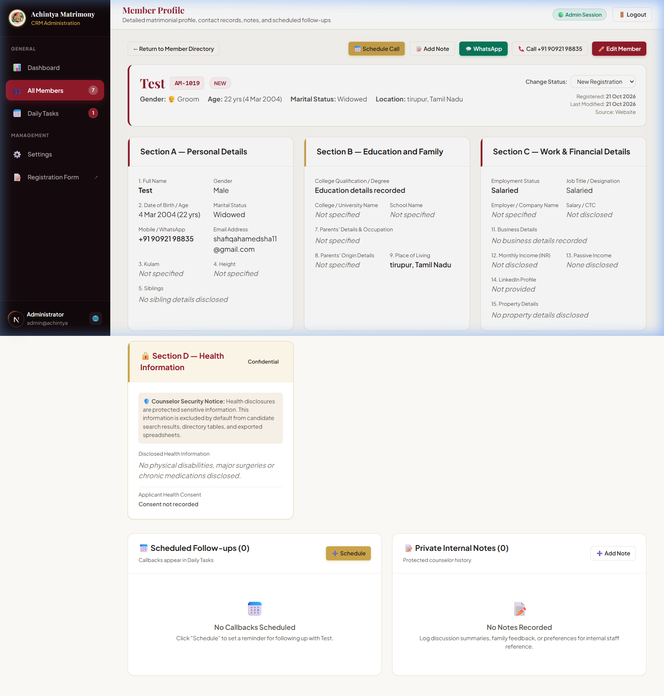

#### Component Breakdown:
1. **Candidate Header Card:** Name, Unique ID, Profile Status Badge, Age, Gender, Current Location, and quick action buttons (Call, WhatsApp, Print Dossier).
2. **Lifecycle Status Switcher:** One-click transition between `Pending Verification` ➔ `Active` ➔ `Matched` ➔ `Inactive`.
3. **Personal & Family Dossier:**
   - Full family tree data: Father's/Mother's profession, ancestral origin, sibling status.
   - Astrological & Horoscope data: Rasi, Nakshatram, Dosham status.
   - Professional & Financial: Company, annual income, asset holdings.
4. **Confidential Counselor Notes:** Private internal log where counselors document conversation findings, family expectations, and astrological requirements.
5. **Follow-up Scheduler:** Set reminders with specific dates and note summaries for upcoming calls.
6. **Matchmaking Engine Suggestions:** Automatically surfaces candidate profiles of the opposite gender meeting age, education, and community criteria.

---

### 4. Admin Tasks & Follow-up Manager (`/admin/tasks`)

Task management designed around counselor call schedules and prospective match follow-ups.

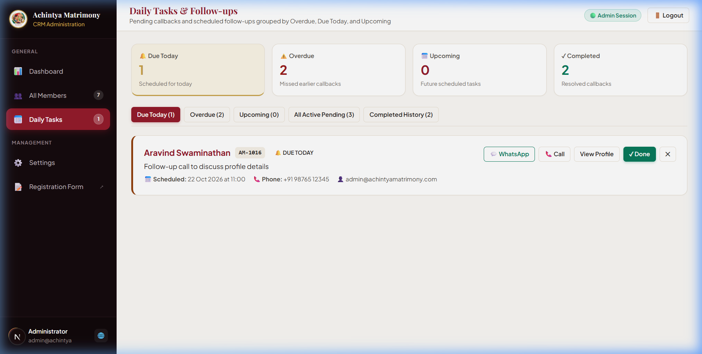

#### Task Buckets:
- **Due Today:** Immediate action list for the counselor's current workday.
- **Overdue:** Urgent backlog requiring immediate rescheduling or customer re-engagement.
- **Upcoming:** Future scheduled consultations and horoscope verification calls.
- **Completed:** Full audit trail of completed outreach efforts.

---

### 5. Application & System Settings (`/admin/settings`)

Configuration management for platform defaults and third-party integrations.

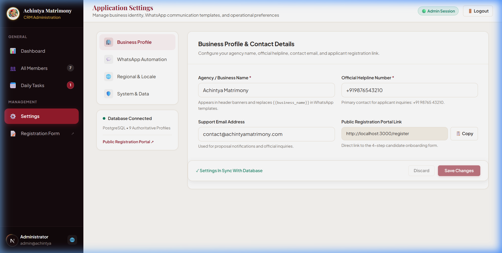

#### Configuration Modules:
- **Business Profile:** Matchmaking firm official name, helpline phone, operational email, physical office address.
- **WhatsApp Communication Templates:** Standardized message templates for *Initial Welcome*, *Verification Request*, and *Match Proposal Delivery*.
- **Regional & Localization Defaults:** Currency formatting (INR ₹), timezone (`Asia/Kolkata`), date format standards (`DD/MM/YYYY`).
- **Database Connection Diagnostics:** Live health indicator confirming PostgreSQL active status.

---

## 🗄️ Database Entity-Relationship Mapping

The data model maintains relational integrity across members, audit notes, follow-up callbacks, and match proposals.

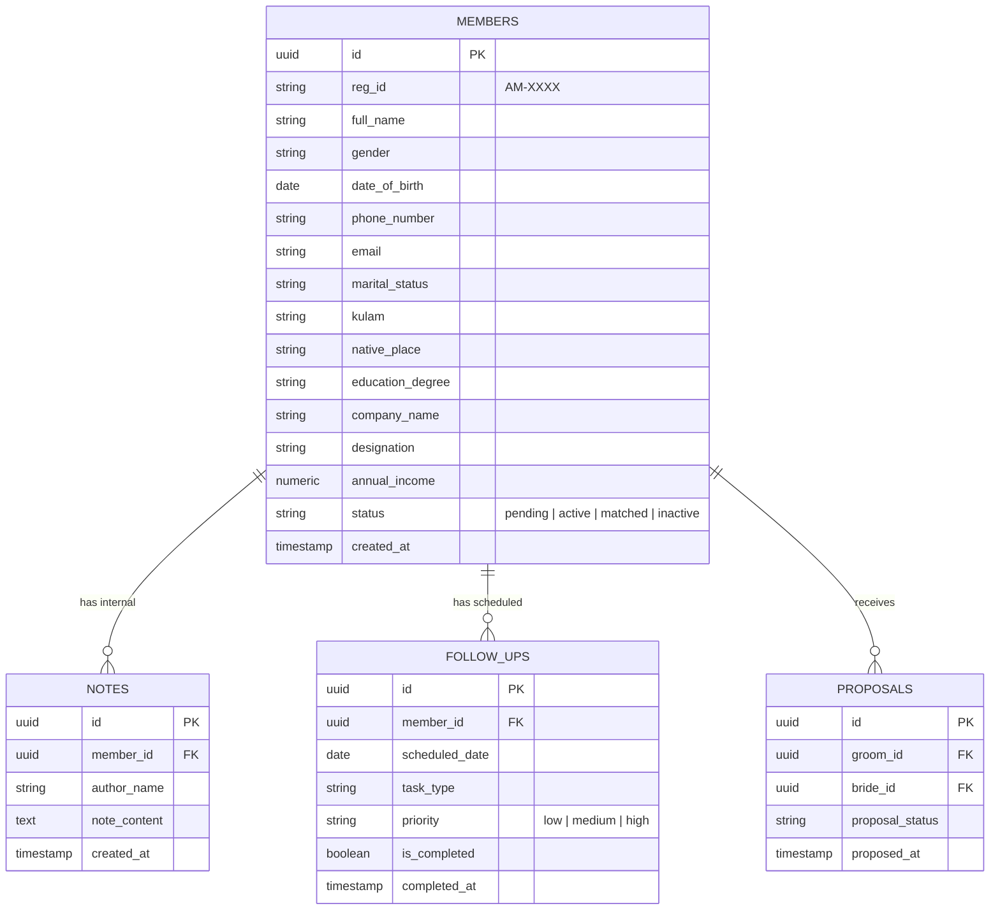

---

## 🚀 Key Takeaways & Operational Best Practices

1. **Confidentiality First:** All candidate phone numbers and sensitive health details remain strictly inside the counselor-accessible CRM and are never exposed publicly.
2. **Proactive Follow-ups:** The built-in `/admin/tasks` engine ensures zero dropped leads, alerting staff to overdue callbacks.
3. **Data Portability:** Counselors can extract full profile databases to `.xlsx` or `.csv` at any moment via the `/admin/members` interface.
